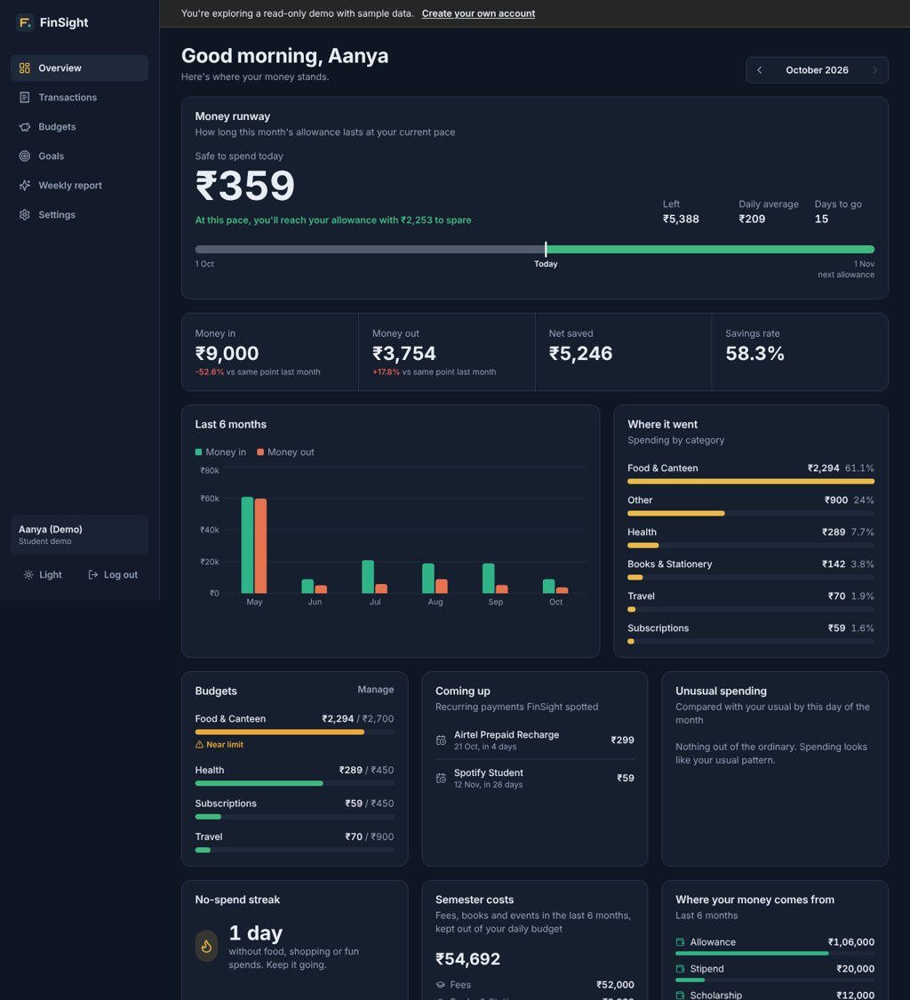
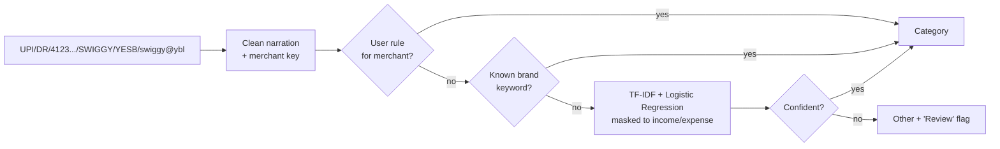
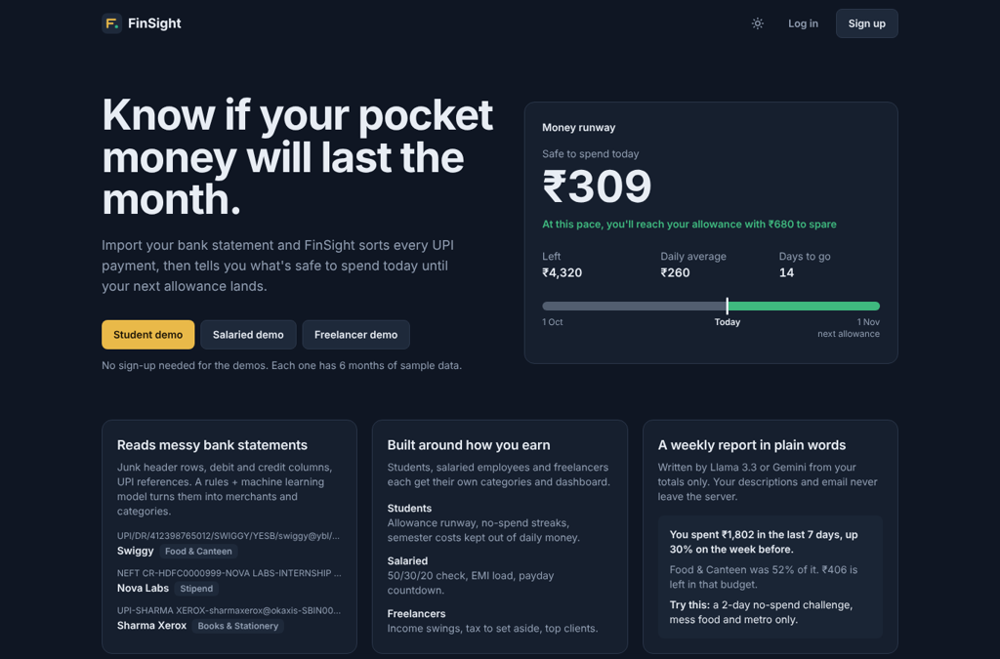
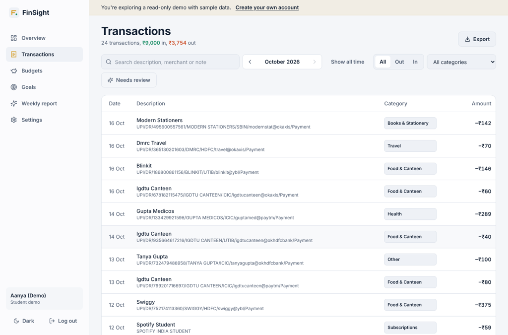
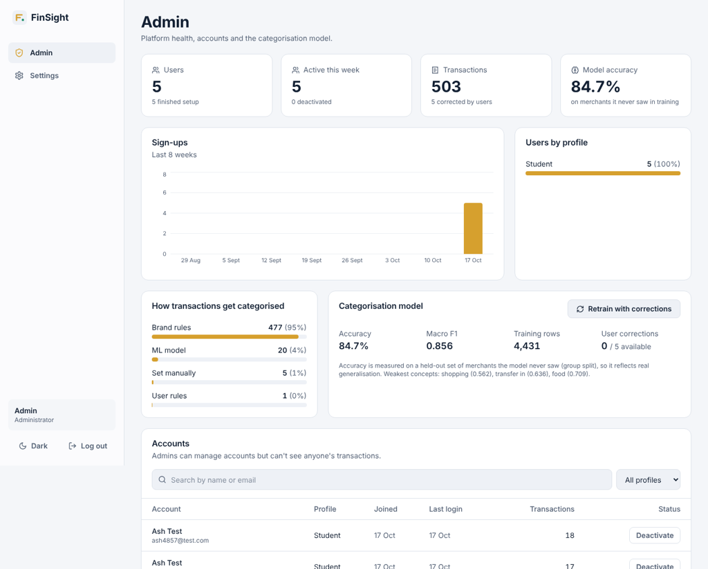

# FinSight

A money tracker built around how people actually earn, starting with students.

Import a bank statement and FinSight sorts every UPI payment into categories, then answers
the question a student on pocket money actually has: **"Will this last until my next allowance?"**
Salaried employees and freelancers get dashboards built for their kind of income too.



**Try it without signing up:** open the app and click *Student demo*, *Salaried demo* or
*Freelancer demo*. Each is a read-only account with 6 months of realistic sample data.

---

## What it does

### For everyone
- **Bank statement import.** Real exports from HDFC, SBI, ICICI and UPI apps: junk rows above the
  header, separate debit/credit columns, `Dr/Cr` flags, `₹1,234.50` / `(120.00)` amounts, mixed
  date formats. Re-uploading the same file doesn't create duplicates.
- **Automatic categories that learn.** Change Swiggy to "Fun" once and every past and future
  Swiggy payment follows.
- **Budgets** with warnings at 80% and alerts at 100%, plus suggested limits from your income.
- **Recurring payment detection.** Netflix, rent, EMIs and SIPs are found automatically, with
  their next due date.
- **Unusual spending alerts.** "Food is at ₹4,190, 2.4× your usual by this day of the month."
- **Weekly report** in plain words with one concrete action, written by an LLM.
- **Savings goals** that tell you how much to save per month to hit the date.
- Dark and light themes, works on mobile.

### Built around how you earn

| | Student | Salaried | Freelancer |
|---|---|---|---|
| Headline number | Safe to spend today | Safe to spend until payday | Average month |
| Special views | Money runway, no-spend streak, semester costs kept out of daily money, income sources (allowance, stipend, scholarship) | 50/30/20 check, EMI load, emergency fund target | Income swings, tax set-aside, top clients |
| Categories | Food & Canteen, Hostel & Rent, Books & Stationery, Fees, Events & Hackathons… | Rent, Groceries, Bills, EMI & Loans, Investments… | Business Expenses, Software & Tools, Taxes… |

### Roles
| Role | How it's created | Can do |
|---|---|---|
| **User** | Sign up | Everything on their own data |
| **Demo** | "Try demo" button | Read-only tour with sample data; all writes are blocked server-side |
| **Admin** | `python manage.py create-admin` only, never via sign-up | Platform stats, deactivate accounts, view model metrics, retrain the model. **Cannot see anyone's transactions.** |

---

## How categorisation works



- The model predicts one of ~27 profile-independent **concepts** (food, rent, stipend…), which are
  then mapped to each profile's categories. One model serves students, employees and freelancers.
- Training data is synthetic but shaped like real bank narrations (UPI, NEFT, POS, ACH formats with
  reference numbers, IFSC codes and VPAs).
- **Evaluation uses a group split by merchant**, so the test set only contains merchants the model has
  never seen. Current score: **~85% accuracy, 0.86 macro-F1** on unseen merchants. Known brands are
  handled by rules, so real-world accuracy is higher.
- User corrections are stored as merchant rules immediately, and an admin can retrain the model with
  all corrections included (each counts 3× a synthetic example).

## Weekly report: free LLMs with a fallback

Provider chain: **Groq (Llama 3.3 70B) → Google Gemini → built-in rules.** Both LLMs have free tiers.
If no key is set or a provider fails, the rule-based writer produces the report, so the feature never
breaks in a demo. Only aggregated numbers are sent to the LLM, never transaction descriptions or emails.
Reports are cached per week and rate-limited to protect the free quota.

---

## Tech stack

**Frontend:** React 18, Vite, Tailwind CSS, Recharts, React Router
**Backend:** Flask, SQLAlchemy, JWT auth, pandas
**ML:** scikit-learn (TF-IDF word + char n-grams, Logistic Regression)
**Database:** SQLite locally, PostgreSQL (Neon) in production
**Testing/CI:** pytest (34 tests), GitHub Actions

```
finance-dashboard/
├── backend/
│   ├── app/
│   │   ├── ml/            # concepts, synthetic dataset, training, hybrid classifier
│   │   ├── models/        # SQLAlchemy models
│   │   ├── routes/        # auth, transactions, budgets+goals, dashboard, insights, admin
│   │   ├── services/      # analytics, AI reports, demo seeding, import logic
│   │   └── utils/         # CSV parser, merchant cleaning, validation, security decorators
│   ├── tests/
│   ├── manage.py          # create-admin, seed-demo, train
│   └── run.py
├── frontend/
│   └── src/
│       ├── components/    # layout, charts, runway track, dialogs
│       ├── pages/         # dashboard, transactions, budgets, goals, insights, admin…
│       ├── context/       # auth
│       └── lib/           # api client, formatting, theme
└── render.yaml
```

---

## Run it locally (Windows, macOS, Linux)

Needs **Python 3.11+** and **Node 18+**. No database install needed: it uses SQLite locally.

**1. Backend** (terminal 1)
```bash
cd backend
python -m venv venv
venv\Scripts\activate            # macOS/Linux: source venv/bin/activate
pip install -r requirements-dev.txt
copy .env.example .env           # macOS/Linux: cp .env.example .env
python run.py                    # http://localhost:5000/api/health
```
The classifier trains itself on first use (about 10 seconds). Add a free `GROQ_API_KEY`
(console.groq.com) or `GEMINI_API_KEY` (aistudio.google.com) to `.env` for LLM-written reports.

**2. Frontend** (terminal 2)
```bash
cd frontend
npm install
npm run dev                      # http://localhost:5173
```

**3. Optional**
```bash
python manage.py create-admin --email admin@example.com   # then log in at /login
python manage.py seed-demo                                 # rebuild demo data
python -m pytest -q                                        # run the tests
```
A sample statement to import is in `frontend/public/sample-statement.csv`.

## Deploy (free)

1. **Database:** create a free Postgres database on [Neon](https://neon.tech) and copy its connection string.
2. **API on Render:** New → Blueprint → pick this repo (uses `render.yaml`). Fill in `DATABASE_URL`,
   `CORS_ORIGINS` (your Vercel URL) and optionally `GROQ_API_KEY` / `GEMINI_API_KEY`.
3. **Frontend on Vercel:** import the repo, root directory `frontend`, framework Vite, and set
   `VITE_API_URL` to `https://<your-render-app>.onrender.com/api`.

Render's free tier sleeps after 15 minutes, so the first request can take ~30 seconds.

## Security notes
- Passwords hashed with Werkzeug (PBKDF2); JWTs expire after 7 days.
- Roles are checked against the database on every request, so deactivation applies immediately.
- Every query is scoped to the logged-in user; tests cover cross-user access (IDOR).
- Role can't be set at sign-up; admins are created from the command line only.

## Screenshots

| Landing | Transactions (light mode) |
|---|---|
|  |  |


